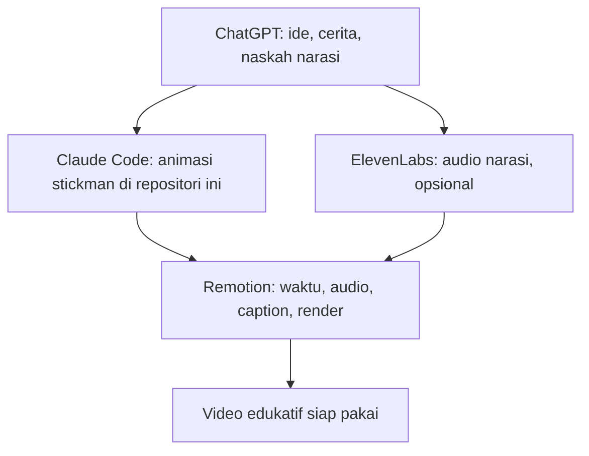

[English](README.md) | **Bahasa Indonesia**

# Stickman Story — Starter Kit

Buat video stickman edukatif sederhana dengan kode. Repositori ini adalah **starter kit edukatif yang disederhanakan**, dibangun dengan
React, [Remotion](https://www.remotion.dev), dan pengembangan yang dibantu AI. Ini **bukan** mesin produksi yang lengkap.

Repositori ini menunjukkan cara membuat dokumenter stickman langkah demi langkah: cara merencanakan cerita, menulis narasi, menganimasikan
karakter, menambahkan suara Anda sendiri, menambahkan caption, dan merender video MP4 vertikal.

Anda tidak perlu menjadi ahli animasi. Jika Anda bisa membaca JavaScript dasar, Anda bisa mengubah contoh-contohnya dan membuat video Anda sendiri.
Kit ini berjalan di komputer Anda sendiri, tanpa akun dan tanpa API key.

> **Cakupan.** Kit publik berisi sekumpulan kecil bagian yang bisa dipakai ulang: karakter stickman, pose berjalan dan duduk, ruangan sederhana,
> kamera, caption, dan tiga contoh. Mesin produksi lengkap dan proyek dokumenter lengkap **tidak** disertakan.

## Daftar isi

- [Untuk siapa ini](#untuk-siapa-ini)
- [Apa yang bisa dibuat](#apa-yang-bisa-dibuat)
- [Alur produksi](#alur-produksi)
- [Teknologi yang digunakan](#teknologi-yang-digunakan)
- [Langkah 1 — Mencari Ide dan Menulis Cerita dengan ChatGPT](#langkah-1--mencari-ide-dan-menulis-cerita-dengan-chatgpt)
- [Langkah 2 — Membuat Animasi dengan Claude Code](#langkah-2--membuat-animasi-dengan-claude-code)
- [Langkah 3 — Membuat Narasi dengan ElevenLabs (opsional)](#langkah-3--membuat-narasi-dengan-elevenlabs-opsional)
- [Langkah 4 — Menginstal dan Menggunakan Remotion](#langkah-4--menginstal-dan-menggunakan-remotion)
- [Instalasi otomatis menggunakan Claude Code](#instalasi-otomatis-menggunakan-claude-code)
- [Opsional: skill agen resmi Remotion](#opsional-skill-agen-resmi-remotion)
- [Langkah 5 — Menyinkronkan Narasi dengan Animasi](#langkah-5--menyinkronkan-narasi-dengan-animasi)
- [Langkah 6 — Menambahkan Caption](#langkah-6--menambahkan-caption)
- [Langkah 7 — Rendering dan Pemeriksaan Video](#langkah-7--rendering-dan-pemeriksaan-video)
- [Contoh adegan](#contoh-adegan)
- [Menyesuaikan karakter, lingkungan, dan kamera](#menyesuaikan-karakter-lingkungan-dan-kamera)
- [Tips menghemat token Claude Code](#tips-menghemat-token-claude-code)
- [Struktur folder proyek](#struktur-folder-proyek)
- [Pemecahan masalah](#pemecahan-masalah)
- [Lisensi dan cakupan edukatif](#lisensi-dan-cakupan-edukatif)
- [Ucapan terima kasih](#ucapan-terima-kasih)

## Untuk siapa ini

- Kreator yang ingin membuat video edukatif singkat tentang teknologi, sains, atau sejarah.
- Pemula yang ingin belajar bagaimana sebuah video bisa ditulis sebagai kode.
- Siapa pun yang ingin memakai alat AI untuk merencanakan, menulis, menganimasikan, dan memberi caption pada sebuah video.

## Apa yang bisa dibuat

- Karakter stickman yang berdiri, berjalan, duduk, dan mengetik.
- Perubahan pakaian dan warna untuk setiap karakter.
- Ruangan sederhana dengan lantai, dinding, meja, kursi, monitor, dan papan tulis.
- Gerakan kamera: pan, zoom, mengikuti karakter, dan mendekat ke sebuah objek.
- Film pendek yang terdiri dari beberapa adegan.
- Narasi MP3 Anda sendiri, dengan caption di atasnya.
- File MP4 vertikal (1080 × 1920, 30 frame per detik).

## Alur produksi



Setiap alat punya tugas sendiri:

| Alat | Tugas dalam alur ini | Yang **tidak** dilakukan |
|---|---|---|
| **ChatGPT** | Merencanakan cerita: topik, kalimat pembuka, narasi, adegan, storyboard, dan prompt untuk Claude Code. | Tidak menulis animasi Remotion. |
| **Claude Code** | Membaca proyek ini dan mengubah kode animasi, satu adegan dalam satu waktu. | Tidak menggantikan pemeriksaan fakta Anda. |
| **ElevenLabs** | Mengubah naskah narasi menjadi suara (opsional). | Tidak diperlukan jika Anda merekam suara sendiri. |
| **Remotion** | Kerangka kerja tempat proyek ini berjalan. Ia menggambar setiap frame, memutar audio, dan merender MP4. | Bukan tahap manual yang terpisah. Anda memakainya lewat proyek dan Claude Code. |

## Teknologi yang digunakan

- **[Remotion](https://www.remotion.dev)**: membuat video dari kode. Setiap frame digambar oleh komponen React.
- **React**: mendeskripsikan apa yang tampil di layar.
- **[TypeScript](https://www.typescriptlang.org)**: JavaScript dengan pengecekan tipe. Ia menangkap banyak kesalahan sebelum Anda merender.
- **SVG**: menggambar setiap bagian stickman dan setiap benda di ruangan sebagai bentuk vektor datar.
- **npm**: memasang paket yang tercantum di `package.json`.

## Langkah 1 — Mencari Ide dan Menulis Cerita dengan ChatGPT

ChatGPT dipakai untuk perencanaan kreatif. Gunakan ChatGPT untuk:

- Mencari topik dokumenter yang menarik.
- Menulis kalimat pembuka yang memancing rasa ingin tahu.
- Melakukan riset dan memeriksa fakta (selalu verifikasi sendiri).
- Menjelaskan konsep yang rumit dengan sederhana.
- Menyusun struktur cerita.
- Menulis naskah narasi.
- Membuat storyboard adegan demi adegan.
- Merencanakan transisi visual.
- Menyiapkan prompt untuk Claude Code.

ChatGPT tidak perlu membuat animasi Remotion. Keluarannya adalah rencana dan naskah. Claude Code yang mengubah rencana itu menjadi kode.

**Periksa fakta sebelum dipublikasikan.** Alat AI bisa keliru. Periksa setiap angka, tanggal, dan klaim terhadap sumber yang terpercaya.

### Contoh prompt (Bahasa Indonesia)

```text
Bantu saya membuat dokumenter edukatif stickman berbahasa Indonesia selama 60 detik tentang cara kecerdasan buatan belajar.

Mulai dengan pertanyaan yang membuat penonton penasaran.

Tulis naskah narasi yang menarik dan santai.

Bagi cerita menjadi lima adegan.

Untuk setiap adegan, sertakan:
- Narasi
- Deskripsi visual
- Aksi karakter
- Gerakan kamera
- Perkiraan durasi

Buat ceritanya mudah dipahami dan cocok untuk Instagram Reels, TikTok, dan YouTube Shorts.
```

### Example prompt (English)

```text
Help me create a 60-second Indonesian educational stickman documentary about how artificial intelligence learns.

Start with a question that makes people curious.

Write an engaging, conversational narration script.

Divide the story into five scenes.

For each scene, include:
- Narration
- Visual description
- Character actions
- Camera movement
- Estimated duration

Make the storytelling easy to understand and suitable for Instagram Reels, TikTok, and YouTube Shorts.
```

## Langkah 2 — Membuat Animasi dengan Claude Code

Claude Code membaca proyek ini, memakai ulang komponen yang sudah ada, mengubah kode adegan, dan bekerja dengan Remotion. Ia bisa:

- Mengubah pakaian dan warna karakter.
- Membuat stickman berjalan dan duduk.
- Membangun lingkungan sederhana.
- Menambahkan pan dan zoom kamera.
- Menerapkan satu adegan dalam satu waktu.
- Men-debug animasi.
- Menjalankan rendering dan pemeriksaan kualitas.

### Strateginya: REUSE → RESKIN → NEW

1. **REUSE** (pakai ulang) komponen atau contoh yang sudah ada persis seperti adanya.
2. **RESKIN** (ganti kulit): ubah warna, teks, posisi, nomor frame, pakaian, atau caption. Sebagian besar adegan baru hanya memerlukan langkah ini.
3. **NEW** (baru): tulis kode baru hanya jika langkah 1 dan 2 tidak cukup.

Selalu periksa komponen publik yang sudah ada sebelum membuat sesuatu yang baru. `CLAUDE.md` mencantumkan lokasi setiap komponen.

### Contoh prompt (Bahasa Indonesia)

```text
Baca CLAUDE.md, README.md, dan dokumentasi komponen yang relevan.

Saya ingin membuat dokumenter edukatif stickman lima adegan berdasarkan storyboard di bawah.

Gunakan karakter stickman, animasi, lingkungan, dan utilitas kamera yang sudah ada sebisa mungkin.

Jangan membuat ulang komponen yang sudah berfungsi.

Kerjakan satu adegan dalam satu waktu.

Validasi TypeScript dan pratinjau setiap adegan sebelum lanjut.

Pertahankan animasi dalam format vertikal 9:16.

Jangan mengubah komposisi yang tidak berhubungan.

Berikut storyboard-nya:

[TEMPEL STORYBOARD DARI CHATGPT]
```

### Example prompt (English)

```text
Read CLAUDE.md, README.md, and the relevant component documentation.

I want to create a five-scene educational stickman documentary based on the storyboard below.

Use existing stickman characters, animations, environments, and camera utilities whenever possible.

Do not recreate working components.

Implement one scene at a time.

Validate TypeScript and preview each scene before proceeding.

Keep the animation in vertical 9:16 format.

Do not modify unrelated compositions.

Here is the storyboard:

[PASTE STORYBOARD FROM CHATGPT]
```

## Langkah 3 — Membuat Narasi dengan ElevenLabs (opsional)

ElevenLabs mengubah naskah menjadi suara. Langkah ini **opsional**. Anda juga bisa merekam narasi sendiri.

- Situs resmi: <https://try.elevenlabs.io/lkcjgejny6xh>
- Harga: <https://try.elevenlabs.io/lkcjgejny6xh>

Apa yang bisa dilakukan ElevenLabs untuk alur ini:

- Mengubah naskah narasi menjadi suara.
- Memilih suara yang tersedia.
- Menghasilkan narasi berbahasa Indonesia.
- Membuat voice clone, jika langganan Anda mencakupnya.
- Mengunduh audio yang dihasilkan.
- Memberi Anda file audio yang bisa diimpor ke starter kit ini.

> **Paket dan lisensi.** ElevenLabs menawarkan paket gratis untuk penggunaan dasar, sementara kemampuan tertentu seperti voice cloning dan hak penggunaan
> komersial memerlukan langganan berbayar yang memenuhi syarat. Paket, batasan, dan ketentuan lisensi dapat berubah. Periksa harga resmi sebelum berlangganan.

**Suara Anda sendiri juga boleh.** Anda bisa merekam narasi sendiri lalu mengimpor file MP3-nya. Anda tidak memerlukan ElevenLabs untuk itu.

**Aturan voice cloning.** Hanya klon suara yang Anda miliki atau yang Anda berhak gunakan. Jangan mengklon suara orang lain tanpa izin mereka.

### Alur kerja

1. Salin naskah narasi dari ChatGPT.
2. Buka ElevenLabs.
3. Pilih suara yang memenuhi syarat, atau voice clone yang Anda punya hak untuk memakainya.
4. Tempel narasinya.
5. Hasilkan audionya.
6. Periksa pengucapan dan tempo.
7. Unduh MP3 (atau format lain yang didukung).
8. Tambahkan audio ke proyek lokal Anda (lihat [Langkah 5](#langkah-5--menyinkronkan-narasi-dengan-animasi)).
9. Sinkronkan timeline animasi dengan durasi narasi yang sebenarnya.

Jangan mempercepat ucapan hanya agar muat dalam panjang adegan yang tetap. Ucapan yang terlalu cepat terdengar seperti robot. Ubah panjang adegannya saja.

### Arahan suara (Bahasa Indonesia)

```text
Gunakan gaya narasi dokumenter Indonesia yang alami dan santai.

Terdengar penasaran, percaya diri, dan menarik, seolah sedang menceritakan kisah yang menakjubkan kepada teman.

Gunakan jeda yang wajar.

Bangun semangat di sekitar fakta yang mengejutkan.

Hindari nada robot, teriakan yang berlebihan, dan gaya pembawa berita.

Jaga pengucapan tetap jelas dan tempo yang konsisten.
```

### Sample voice direction (English)

```text
Use a natural, conversational Indonesian documentary narration style.

Sound curious, confident, and engaging, as if explaining a fascinating story to a friend.

Use natural pauses.

Build excitement around surprising facts.

Avoid robotic delivery, exaggerated shouting, and news-anchor presentation.

Keep pronunciation clear and pacing consistent.
```

## Langkah 4 — Menginstal dan Menggunakan Remotion

Remotion adalah kerangka kerja berbasis React untuk membuat video dari kode. Ia menangani:

- Animasi berbasis frame.
- Komposisi adegan.
- Gerakan kamera.
- Audio.
- Caption.
- Pratinjau di browser.
- Rendering ke MP4.

Tautan resmi:

- GitHub: <https://github.com/remotion-dev/remotion>
- Situs web: <https://www.remotion.dev/>
- Dokumentasi: <https://www.remotion.dev/docs/the-fundamentals>
- Skill AI dan agen: <https://www.remotion.dev/docs/ai/skills>

### Persyaratan

- **Node.js dan npm.** Kit ini diuji dengan Node.js 24.18.0 dan npm 11.16.0. Periksa versi Anda dengan `node -v` dan `npm -v`.
- **Git** (untuk mengklon repositori).
- **Dependensi** tercantum di `package.json`. Versi yang tepat dikunci di `package-lock.json`.
- **Sistem operasi.** Kit ini diuji hanya di **Windows 11**. Sistem lain belum diverifikasi.

### Opsi A — Klon Starter Kit Stickman ini (disarankan)

```bash
git clone https://github.com/ahmadaryanto/stickman-story.git
cd stickman-story
npm ci
```

`npm ci` memasang versi yang tepat dari `package-lock.json`. Gunakan perintah ini jika file tersebut ada. Ini adalah perintah yang disarankan untuk repositori ini.

Lalu periksa bahwa proyek bisa dikompilasi:

```bash
npm run typecheck
```

Jika berjalan bersih, tidak ada error yang tercetak.

### Menjalankan Remotion Studio

```bash
npm run studio
```

Terminal akan memberi tahu saat server siap, di `http://localhost:3000`. Buka alamat itu di browser Anda, lalu pilih komposisi dari daftar.

### Melihat komposisi yang tersedia

```bash
npx remotion compositions src/index.ts
```

Perintah ini mencantumkan tiga komposisi: `Example01-WalkingStickman`, `Example02-OfficeScene`, dan `Example03-MiniDocumentary`.

### Merender video

Gunakan ID komposisi dan path output. Folder `out/` dibuat otomatis.

```bash
npm run render -- Example01-WalkingStickman out/example01.mp4
```

Simpan satu gambar diam (satu frame) untuk memeriksa suatu momen sebelum render penuh:

```bash
npm run still -- Example02-OfficeScene out/check.png --frame=300
```

### Opsi B — Membuat proyek Remotion baru

Anda juga bisa memulai proyek Remotion terpisah dari nol. Ini adalah alternatif untuk kit ini, bukan langkah tambahan untuknya.

```bash
npx create-video@latest
```

Jalankan ini di **folder baru**, jangan pernah di dalam repositori starter kit ini. Periksa perintah terbaru di dokumentasi resmi Remotion
(<https://www.remotion.dev/docs/the-fundamentals>) sebelum menjalankannya, karena perintah itu bisa berubah.

## Instalasi otomatis menggunakan Claude Code

Claude Code bisa memeriksa repositori yang sudah diklon dan membantu mengatur dependensinya. Beberapa tindakan instalasi mungkin memerlukan
persetujuan Anda, jadi baca setiap langkah sebelum Anda menyetujuinya.

### Prompt instalasi (Bahasa Indonesia)

```text
Baca README.md, CLAUDE.md, package.json, dan file lockfile paket yang tersedia.

Periksa apakah Node.js, npm, Git, dan dependensi Remotion sudah terpasang.

Pasang hanya dependensi yang hilang dan dibutuhkan oleh proyek publik ini.

Pertahankan package manager yang sekarang dan versi dependensi yang ada.

Jangan membuat proyek baru.

Jangan mengubah file sumber yang tidak berhubungan.

Pastikan Remotion Studio dapat dijalankan.

Tampilkan semua komposisi yang tersedia.

Jalankan perintah validasi TypeScript yang sudah ada.

Lakukan uji render singkat menggunakan salah satu komposisi contoh yang sudah ada.

Laporkan setiap error instalasi atau kompatibilitas.

Jangan melakukan commit atau push.
```

### Setup prompt (English)

```text
Read README.md, CLAUDE.md, package.json, and the available package lockfile.

Check whether Node.js, npm, Git, and Remotion dependencies are installed.

Install only missing dependencies required by this public project.

Preserve the current package manager and existing dependency versions.

Do not scaffold a new project.

Do not modify unrelated source files.

Verify that Remotion Studio can start.

List all available compositions.

Run the existing TypeScript validation command.

Perform a short test render using an existing example composition.

Report any installation or compatibility errors.

Do not commit or push.
```

## Opsional: skill agen resmi Remotion

Remotion menyediakan panduan opsional untuk agen pemrograman, yang disebut skill agen. Lihat <https://www.remotion.dev/docs/ai/skills>.

Halaman resmi mencantumkan perintah instalasi ini:

```bash
npx skills add remotion-dev/skills
```

**Ini opsional dan memerlukan persetujuan Anda.** Halaman itu tidak menjelaskan apakah perintah tersebut memasang secara global atau hanya di satu proyek,
jadi periksa setiap pertanyaan yang ditampilkannya sebelum Anda menyetujui. Jangan memasang skill global tanpa membaca apa yang diubahnya.

Pisahkan dua jenis panduan ini:

- **Skill resmi Remotion:** panduan umum untuk menerapkan Remotion di proyek mana pun.
- **Instruksi repositori ini** (`CLAUDE.md`, `README.md`): khusus untuk karakter, adegan, dan bagian yang bisa dipakai ulang dari starter kit ini.

## Langkah 5 — Menyinkronkan Narasi dengan Animasi

Kit ini bisa memutar MP3 yang Anda sediakan. Kit ini **tidak** mendeteksi panjang audio Anda atau memotong animasi mengikutinya secara otomatis.
Anda mengatur waktunya sendiri, dalam frame (30 frame = 1 detik).

1. **Impor MP3.** Salin ke `public/audio/`. Contoh: `public/audio/narasi-saya.mp3`.
2. **Cari panjangnya.** Buka file itu di pemutar audio apa pun, atau di editor Anda, lalu catat durasinya dalam detik. Kalikan 30 untuk mendapatkan frame.
3. **Cocokkan adegan dengan narasi.** Di `src/scenes/Example03MiniDocumentary.tsx`, konstanta `SCENE1`, `SCENE2`, dan `SCENE3` mengatur
   frame awal dan panjang setiap adegan. Pastikan total panjang adegan minimal sama dengan narasi.
4. **Putar narasinya.** Berikan file itu ke komposisi:

   ```bash
   npm run render -- Example03-MiniDocumentary out/mini.mp4 --props='{"narration":"audio/narasi-saya.mp3"}'
   ```

5. **Pratinjau dan sesuaikan.** Buka Remotion Studio, pastikan tidak ada kata yang terpotong, dan ubah panjang adegan bila perlu.

Panduan:

- **Pertahankan tempo ucapan yang alami.** Perpanjang adegan yang membutuhkan waktu lebih, daripada mempercepat ucapan.
- **Jangan memotong kata.** Pastikan setiap adegan berlangsung sampai narasinya selesai.
- **Seimbangkan volume.** Komponen `Narration` punya nilai `volume` dari 0 sampai 1. Nilai bawaannya 0,9.
- **Jauhkan file narasi dari Git.** Repositori mengabaikan file audio di `public/audio/` kecuali satu file penanda.

### Prompt audio (Bahasa Indonesia)

```text
Impor file narasi saya di public/audio/[NAMA-FILE].mp3 ke Example03MiniDocumentary.

Baca durasi narasi dari file tersebut dan ubah menjadi frame pada 30 fps.

Sesuaikan SCENE1, SCENE2, dan SCENE3 agar total durasi adegan minimal sama dengan narasi, tanpa memotong kata apa pun.

Jangan mempercepat atau memperlambat narasi.

Berikan file ke komposisi melalui prop narration, lalu validasi TypeScript.

Pratinjau hasilnya dan laporkan adegan yang terasa terlalu pendek atau terlalu panjang.
```

### Audio prompt (English)

```text
Import my narration file at public/audio/[FILENAME].mp3 into Example03MiniDocumentary.

Read the narration length from the file and convert it to frames at 30 fps.

Adjust SCENE1, SCENE2 and SCENE3 so the scenes together last at least as long as the narration, without cutting any words.

Do not speed up or slow down the narration.

Pass the file to the composition with the narration prop, and validate TypeScript.

Preview the result and report any scene that feels too short or too long.
```

## Langkah 6 — Menambahkan Caption

Caption adalah teks biasa di layar, yang muncul pada frame yang Anda pilih. Starter kit menyediakan komponen caption dasar, `CaptionTrack`.
Ini **bukan** sistem subtitle otomatis: Anda menulis setiap caption dan waktunya sendiri.

Yang didukung komponen publik ini:

- Teks, hingga dua baris (gunakan `\n` untuk baris kedua).
- Frame awal (`from`) dan frame akhir (`to`).
- Empat posisi bernama (`top`, `upper`, `mid`, `lower`), atau tinggi apa pun dengan `y` dalam piksel. Nilai bawaannya `lower`.
- Margin 90 piksel di kiri dan kanan.
- Huruf 54 piksel (Inter, dari Google Fonts), warna teks terang, dan bayangan gelap.

```tsx
import {CaptionCue, CaptionTrack} from "../captions/CaptionTrack";

const CAPTIONS: CaptionCue[] = [
  {from: 10, to: 80, text: "Meet our stickman.", pos: "lower"},
  {from: 100, to: 200, text: "Here is the first idea.", pos: "lower"},
];

<CaptionTrack cues={CAPTIONS} />
```

### Daftar periksa caption

- **Sinkron dengan narasi.** Atur `from` dan `to` berdasarkan kata yang Anda dengar di Remotion Studio.
- **Letakkan di sepertiga bawah.** Posisi `lower` bawaan menyisakan ruang untuk karakter di atasnya.
- **Pastikan mudah dibaca.** Gunakan frasa pendek, dan periksa apakah teks tetap terbaca di latar belakang yang terang.
- **Gunakan margin aman.** Jaga teks di dalam margin samping 90 piksel dan jauh dari tepi bawah, tempat aplikasi ponsel menampilkan kontrolnya sendiri.
- **Hindari objek penting.** Jangan menutupi wajah karakter atau diagram kunci. Pindahkan caption dengan `pos` atau `y`.
- **Pratinjau sebelum render.** Simpan satu gambar diam di awal setiap caption, dan satu lagi di tengahnya.

Kit publik ini tidak menyertakan sistem penghindaran tabrakan otomatis. Periksa posisinya sendiri.

### Prompt caption (Bahasa Indonesia)

```text
Gunakan komponen caption publik yang sudah ada untuk menambahkan caption yang tersinkron ke dokumenter saya.

Sesuaikan waktu caption dengan waktu narasi.

Letakkan teks di posisi lower-third yang mudah dibaca.

Hindari menutupi karakter stickman dan diagram penting.

Pertahankan narasi dan animasi asli.

Validasi waktu caption sebelum merender.
```

### Caption prompt (English)

```text
Use the existing public caption component to add synchronized captions to my documentary.

Match the captions to the narration timing.

Keep the text in a readable lower-third position.

Avoid covering the stickman character and important diagrams.

Preserve the original voiceover and animation.

Validate the caption timing before rendering.
```

## Langkah 7 — Rendering dan Pemeriksaan Video

Kualitas video harus diperiksa dengan mata. Render yang selesai tanpa error tetap bisa memiliki caption yang salah, gerakan berjalan yang patah, atau kata yang terpotong.

1. **Buka Remotion Studio** (`npm run studio`) dan buka komposisinya.
2. **Pratinjau setiap adegan.** Geser timeline, dan tonton setiap adegan secara utuh setidaknya sekali.
3. **Periksa sinkronisasi audio.** Dengarkan kata yang terpotong di awal atau akhir adegan.
4. **Periksa gerakan karakter.** Kaki harus tetap di lantai saat karakter berjalan.
5. **Periksa caption.** Setiap caption harus muncul di waktu yang tepat, mudah dibaca, dan tidak menutupi isi penting.
6. **Periksa gerakan kamera.** Waspadai lompatan atau berhenti mendadak.
7. **Periksa teks yang meluber.** Tidak boleh ada teks yang keluar dari tepi frame.
8. **Simpan gambar diam** untuk momen yang Anda ragukan, dengan `npm run still`.
9. **Render file akhir** dengan `npm run render`, lalu tonton MP4 dari awal sampai akhir.

## Contoh adegan

Setiap contoh adalah komposisi yang lengkap. Buka di Remotion Studio, lalu ubah untuk membuat versi Anda sendiri.

### Contoh 01 — Stickman berjalan

- **Komposisi:** `Example01-WalkingStickman` (5 detik).
- **File:** `src/scenes/Example01WalkingStickman.tsx`.
- **Komponen:** `Stickman` (rig), `walk` (pose), `idle` (pose), `Camera2D` dan `Layer` (kamera), `Wall` dan `Floor` (lingkungan), `CaptionTrack` (caption).
- **Yang bisa diubah:** posisi awal dan akhir (`START_X`, `END_X`), ukuran (`scale`), seberapa jauh kamera mengikuti, dan teks caption.
- **Pratinjau:** `npm run studio`, lalu pilih `Example01-WalkingStickman`.
- **Render:** `npm run render -- Example01-WalkingStickman out/example01.mp4`.

### Contoh 02 — Adegan kantor

- **Komposisi:** `Example02-OfficeScene` (12 detik).
- **File:** `src/scenes/Example02OfficeScene.tsx`.
- **Komponen:** `Stickman` dengan `anchor="hip"`, `seatedAnchor` (duduk), `typing` (pose), `walk`, `OfficeChair`, `Desk`, `Monitor` (dengan layar kustom), `Camera2D`, `CaptionTrack`.
- **Yang bisa diubah:** posisi kursi, meja, dan monitor (`CHAIR`, `DESK`), pakaian (`JACKET_BLUE`), target keyboard, keyframe kamera, dan caption.
- **Pratinjau:** `npm run studio`, lalu pilih `Example02-OfficeScene`.
- **Render:** `npm run render -- Example02-OfficeScene out/example02.mp4`.

### Contoh 03 — Mini dokumenter

- **Komposisi:** `Example03-MiniDocumentary` (11 detik, tiga adegan).
- **File:** `src/scenes/Example03MiniDocumentary.tsx`.
- **Komponen:** `Sequence` (tiga adegan), `Stickman` dengan pose `point`, `Board`, `Label`, `Glow`, `Camera2D`, `CaptionTrack`, `Narration` (audio opsional).
- **Yang bisa diubah:** panjang adegan (`SCENE1`, `SCENE2`, `SCENE3`), teks papan tulis, label diagram, caption, dan file narasi.
- **Pratinjau:** `npm run studio`, lalu pilih `Example03-MiniDocumentary`.
- **Render tanpa suara:** `npm run render -- Example03-MiniDocumentary out/mini.mp4`.
- **Render dengan narasi:** `npm run render -- Example03-MiniDocumentary out/mini.mp4 --props='{"narration":"audio/narasi-saya.mp3"}'`.

Contoh-contoh ini hanya memakai konten umum. Mereka tidak meniru adegan dokumenter apa pun.

## Menyesuaikan karakter, lingkungan, dan kamera

### Karakter

Karakter adalah satu komponen `Stickman`. Ubah pakaiannya dengan objek look:

```tsx
import {CASUAL} from "../rig/looks";
import type {Look} from "../rig/Stickman";

const TEACHER: Look = {...CASUAL, top: "#6B3E2E", coat: "#2A2D33"};
```

Preset: `CASUAL`, `SHIRT_ORANGE`, dan `JACKET_BLUE` (di `src/rig/looks.tsx`). Opsi lengkap: [`docs/CHARACTER_GUIDE.md`](docs/CHARACTER_GUIDE.md).

### Lingkungan

Benda-benda ruangan ada di `src/environment/Furniture.tsx`: `Wall`, `Floor`, `Desk`, `Monitor`, `OfficeChair`, `Board`, `Label`, `Glow`, dan `Cone`.
Gambar dari belakang ke depan, di atas layer. Panduan lengkap: [`docs/SCENE_GUIDE.md`](docs/SCENE_GUIDE.md).

### Kamera

Kamera adalah jendela ke dunia 2D. Berikan posisi dan zoom untuk setiap momen:

```tsx
const cam = keysObj(frame, [
  [0,   {x: -300, y: 100, zoom: 1,   rot: 0}],
  [300, {x: 240,  y: 200, zoom: 1.7, rot: 0}],
]);
<Camera2D cam={cam} t={t}> ... </Camera2D>
```

Letakkan karakter di `<Layer depth={1}>`, dan dinding yang jauh di `<Layer depth={0.5}>`. Panduan lengkap: [`docs/CAMERA_GUIDE.md`](docs/CAMERA_GUIDE.md).

## Tips menghemat token Claude Code

Praktik ini membantu Claude Code memakai konteks lebih sedikit dan menghindari pekerjaan yang berulang. Ini mengurangi pemakaian konteks yang tidak perlu, tetapi tidak menjamin pengurangan biaya yang tetap.

1. Baca `CLAUDE.md` terlebih dahulu.
2. Baca hanya dokumentasi proyek yang Anda perlukan.
3. Cari komponen yang sudah ada sebelum menulis yang baru.
4. Ikuti REUSE → RESKIN → NEW.
5. Terapkan satu adegan dalam satu waktu.
6. Hindari membaca ulang seluruh file sumber berkali-kali. Minta fungsi atau baris yang spesifik.
7. Gunakan pencarian yang terarah.
8. Validasi secara lokal (`npm run typecheck`, gambar diam) sebelum render penuh.
9. Jaga tugas tetap kecil.
10. Gunakan model yang lebih mampu untuk desain yang kompleks, dan model yang lebih ringan untuk perubahan rutin, jika alat Anda menyediakan pilihan itu.

## Struktur folder proyek

```
src/
  index.ts              titik masuk (mendaftarkan root)
  Root.tsx              tiga komposisi contoh
  styles/palette.ts     warna, font, ukuran frame (1080 x 1920, 30 fps)
  rig/Stickman.tsx      rig stickman (badan, anggota tubuh, wajah, topi, IK)
  rig/poses.ts          idle, walk, sit, typing, point, cheer, mix
  rig/looks.tsx         preset pakaian dan rambut sederhana
  rig/seat.ts           seatedAnchor: duduk di kursi
  motion/ease.ts        easing, keyframe, spline
  camera/Camera2D.tsx   kamera virtual dan layer paralaks
  environment/Furniture.tsx   lantai, dinding, meja, monitor, kursi, papan tulis
  captions/CaptionTrack.tsx   caption berwaktu
  audio/Narration.tsx   narasi MP3 opsional
  scenes/Example0*.tsx  tiga contoh
public/audio/           tempat file narasi MP3 Anda (tidak ada audio yang disertakan)
docs/                   panduan (termasuk GITHUB_RELEASE_GUIDE.md)
CLAUDE.md               instruksi untuk Claude Code
```

## Pemecahan masalah

**`npm ci` atau `npm install` gagal.** Periksa `node -v`. Kit ini diuji dengan Node.js 24. Hapus folder `node_modules`, lalu jalankan `npm ci` lagi.

**`npm run typecheck` menampilkan error.** Baca baris pertama error. Di sana tertulis file dan barisnya. Penyebab umum adalah objek kamera tanpa `rot`. Tambahkan `rot: 0`.

**Pratinjau kosong, atau browser tidak bisa terhubung.** Periksa terminal. `npm run studio` seharusnya melaporkan bahwa server siap di `http://localhost:3000`.
Jika port 3000 sedang dipakai, tutup program yang memakainya, lalu jalankan `npm run studio` lagi.

**Render gagal dengan pesan tentang browser.** Remotion mengunduh browser headless pada pertama kali. Periksa koneksi internet Anda, lalu jalankan perintah lagi.

**Caption memakai font biasa.** Font Inter dimuat dari Google Fonts. Periksa koneksi Anda, lalu coba lagi.

**Karakter melayang di atas tanah atau tenggelam ke dalamnya.** Karakter yang berdiri memerlukan `y={FLOOR}`. Karakter yang duduk memerlukan `anchor="hip"` dengan `seatedAnchor`.

**Video tidak ada suaranya.** Contoh dibuat tanpa suara dengan sengaja. Untuk mendengar narasi, lihat [Langkah 5](#langkah-5--menyinkronkan-narasi-dengan-animasi).

**Caption menutupi karakter atau objek.** Ubah `pos`-nya, atau atur nilai `y`. Periksa posisinya di gambar diam.

**Sebuah kata narasi terpotong di akhir.** Perpanjang adegannya. Jangan mempercepat audio agar muat.

Bantuan lainnya: [`docs/GETTING_STARTED.md`](docs/GETTING_STARTED.md).

## Lisensi dan cakupan edukatif

- **Kode:** Lisensi MIT. Lihat [`LICENSE`](LICENSE). Anda boleh memakai, mengubah, dan membagikan kode ini, termasuk untuk tujuan komersial, dengan tetap mencantumkan pemberitahuan hak cipta.
- **Dokumentasi** (`README.md`, `README.id.md`, `CLAUDE.md`, dan `docs/`): Creative Commons Attribution 4.0 (CC BY 4.0). Lihat [`docs/LICENSE.md`](docs/LICENSE.md).
- **Remotion** memiliki lisensinya sendiri. Ia gratis untuk individu dan organisasi dengan hingga 3 karyawan. Organisasi komersial yang lebih besar memerlukan lisensi perusahaan. Lihat <https://www.remotion.dev/license>.
- **ElevenLabs** memiliki ketentuan penggunaan dan batasan paketnya sendiri. Lihat <https://try.elevenlabs.io/lkcjgejny6xh>.
- **Inter** (font caption) dimuat dari Google Fonts saat Anda merender. Tidak ada file font yang disertakan.
- **Tidak ada audio, gambar, atau logo yang disertakan.** Narasi menjadi tanggung jawab Anda. Gunakan hanya audio dan suara yang Anda berhak memakainya.
- **Layanan dan aset pihak ketiga:** repositori ini tidak memberikan hak apa pun atas alat, suara, font, atau aset pihak ketiga lainnya.

Ini adalah **starter kit edukatif publik**. Ini bukan mesin produksi dokumenter pribadi yang lengkap. Ia tidak menyertakan kode sumber dokumenter lengkap, sistem transisi lanjutan, registri aset pribadi, rekaman suara pribadi, atau instruksi AI pribadi.

## Ucapan terima kasih

- Dibangun dengan [Remotion](https://www.remotion.dev), React, dan [TypeScript](https://www.typescriptlang.org).
- Font caption adalah [Inter](https://rsms.me/inter/) karya Rasmus Andersson, dimuat dari Google Fonts.
- Alat alur kerja yang disebut dalam panduan ini: ChatGPT, [Claude Code](https://claude.com/claude-code), dan [ElevenLabs](https://try.elevenlabs.io/lkcjgejny6xh).
