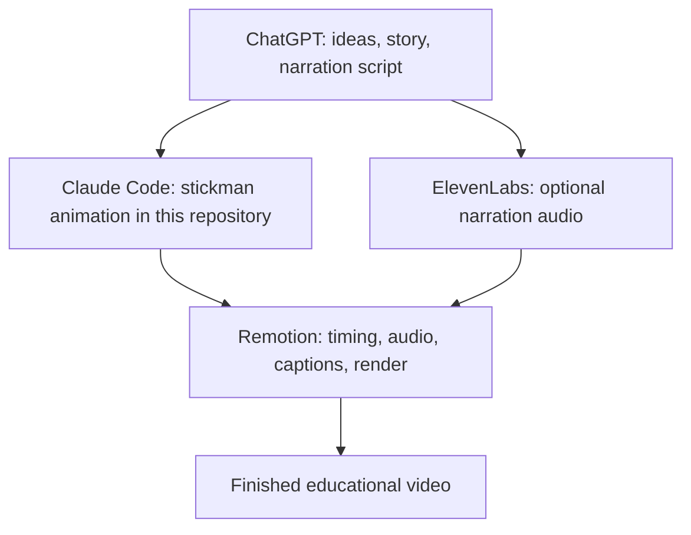

**English** | [Bahasa Indonesia](README.id.md)

# Stickman Story — Starter Kit

Create simple, educational stickman videos with code. This repository is a **simplified educational starter kit** built with
React, [Remotion](https://www.remotion.dev) and AI-assisted development. It is not a complete production engine.

It shows you how to build a stickman documentary step by step: how to plan the story, write the narration, animate a character,
add your own voice, add captions, and render a vertical MP4 video.

You don't need to be an animation expert. If you can read basic JavaScript, you can change the examples and build your own.
The kit runs on your own computer, and it needs no account and no API key.

> **Scope.** The public kit contains a small set of reusable parts: a stickman, walking and sitting poses, a simple room, a camera,
> captions, and three examples. The full production engine and the full documentary projects are **not** included.

## Contents

- [Who this is for](#who-this-is-for)
- [What you can build](#what-you-can-build)
- [The production workflow](#the-production-workflow)
- [Technology used](#technology-used)
- [Step 1 — Ideation with ChatGPT](#step-1--ideation-with-chatgpt)
- [Step 2 — Build animations with Claude Code](#step-2--build-animations-with-claude-code)
- [Step 3 — Generate narration with ElevenLabs (optional)](#step-3--generate-narration-with-elevenlabs-optional)
- [Step 4 — Install and use Remotion](#step-4--install-and-use-remotion)
- [Set up the project automatically with Claude Code](#set-up-the-project-automatically-with-claude-code)
- [Optional: official Remotion agent skills](#optional-official-remotion-agent-skills)
- [Step 5 — Synchronize narration with animation](#step-5--synchronize-narration-with-animation)
- [Step 6 — Add captions](#step-6--add-captions)
- [Step 7 — Render and review](#step-7--render-and-review)
- [Example scenes](#example-scenes)
- [Customize characters, environments and camera](#customize-characters-environments-and-camera)
- [Saving tokens with Claude Code](#saving-tokens-with-claude-code)
- [Project folders](#project-folders)
- [Troubleshooting](#troubleshooting)
- [License and educational scope](#license-and-educational-scope)
- [Acknowledgments](#acknowledgments)

## Who this is for

- Creators who want to make short educational videos about technology, science or history.
- Beginners who want to learn how a video can be written as code.
- Anyone who wants to use AI tools to plan, write, animate and caption a video.

## What you can build

- A stickman that stands, walks, sits and types.
- Clothing and colour changes for each character.
- A simple room with a floor, a wall, a desk, a chair, a monitor and a whiteboard.
- Camera moves: pan, zoom, follow a character and push in on an object.
- A short film made of several scenes.
- Your own MP3 narration, with captions on top.
- A vertical MP4 file (1080 × 1920, 30 frames per second).

## The production workflow



Each tool has one job:

| Tool | Job in this workflow | What it does **not** do |
|---|---|---|
| **ChatGPT** | Plans the story: topic, hook, narration, scenes, storyboard, prompts for Claude Code. | It does not write the Remotion animation. |
| **Claude Code** | Reads this project and edits the animation code, one scene at a time. | It does not replace your fact-checking. |
| **ElevenLabs** | Turns your narration script into speech (optional). | It is not needed if you record your own voice. |
| **Remotion** | The framework this project runs on. It draws each frame, plays the audio and renders the MP4. | It is not a separate manual stage. You use it through the project and Claude Code. |

## Technology used

- **[Remotion](https://www.remotion.dev)**: creates video from code. Each frame is drawn by a React component.
- **React**: describes what is on the screen.
- **[TypeScript](https://www.typescriptlang.org)**: JavaScript with type checking. It catches many mistakes before you render.
- **SVG**: draws every stickman part and room piece as flat vector shapes.
- **npm**: installs the packages listed in `package.json`.

## Step 1 — Ideation with ChatGPT

ChatGPT is used for creative planning. Use it to:

- Find interesting documentary topics.
- Write curiosity-driven hooks.
- Research and fact-check claims (always verify them yourself).
- Explain complicated concepts simply.
- Develop the storytelling structure.
- Write narration scripts.
- Create scene-by-scene storyboards.
- Plan visual transitions.
- Prepare prompts for Claude Code.

ChatGPT does not need to generate the Remotion animation. Its output is a plan and a script. Claude Code turns the plan into code.

**Verify facts before you publish.** AI tools can be wrong. Check every number, date and claim against a reliable source.

### Example prompt (English)

```text
Help me create a 60-second Indonesian educational stickman documentary about how artificial intelligence learns.

Start with a question that makes people curious.

Write an engaging, conversational narration script.

Divide the story into five scenes.

For each scene, include:
- Narration
- Visual description
- Character actions
- Camera movement
- Estimated duration

Make the storytelling easy to understand and suitable for Instagram Reels, TikTok, and YouTube Shorts.
```

### Contoh prompt (Bahasa Indonesia)

```text
Bantu saya membuat dokumenter edukatif stickman berbahasa Indonesia selama 60 detik tentang cara kecerdasan buatan belajar.

Mulai dengan pertanyaan yang membuat penonton penasaran.

Tulis naskah narasi yang menarik dan santai.

Bagi cerita menjadi lima adegan.

Untuk setiap adegan, sertakan:
- Narasi
- Deskripsi visual
- Aksi karakter
- Gerakan kamera
- Perkiraan durasi

Buat ceritanya mudah dipahami dan cocok untuk Instagram Reels, TikTok, dan YouTube Shorts.
```

## Step 2 — Build animations with Claude Code

Claude Code reads this project, reuses its existing components, modifies scene code and works with Remotion. It can:

- Customize a character's clothes and colours.
- Make a stickman walk and sit.
- Build a simple environment.
- Add camera pan and zoom.
- Implement one scene at a time.
- Debug an animation.
- Run the rendering and quality checks.

### The strategy: REUSE → RESKIN → NEW

1. **REUSE** an existing component or example exactly as it is.
2. **RESKIN** it by changing colours, text, positions, frame numbers, clothes or captions. Most new scenes need only this.
3. **NEW**: write new code only when 1 and 2 cannot do the job.

Always inspect the existing public components before you create anything new. `CLAUDE.md` lists where each component is.

### Example prompt (English)

```text
Read CLAUDE.md, README.md, and the relevant component documentation.

I want to create a five-scene educational stickman documentary based on the storyboard below.

Use existing stickman characters, animations, environments, and camera utilities whenever possible.

Do not recreate working components.

Implement one scene at a time.

Validate TypeScript and preview each scene before proceeding.

Keep the animation in vertical 9:16 format.

Do not modify unrelated compositions.

Here is the storyboard:

[PASTE STORYBOARD FROM CHATGPT]
```

### Contoh prompt (Bahasa Indonesia)

```text
Baca CLAUDE.md, README.md, dan dokumentasi komponen yang relevan.

Saya ingin membuat dokumenter edukatif stickman lima adegan berdasarkan storyboard di bawah.

Gunakan karakter stickman, animasi, lingkungan, dan utilitas kamera yang sudah ada sebisa mungkin.

Jangan membuat ulang komponen yang sudah berfungsi.

Kerjakan satu adegan dalam satu waktu.

Validasi TypeScript dan pratinjau setiap adegan sebelum lanjut.

Pertahankan animasi dalam format vertikal 9:16.

Jangan mengubah komposisi yang tidak berhubungan.

Berikut storyboard-nya:

[TEMPEL STORYBOARD DARI CHATGPT]
```

## Step 3 — Generate narration with ElevenLabs (optional)

ElevenLabs converts a script into speech. It is **optional**. You can record your own narration instead.

- Official website: <https://try.elevenlabs.io/lkcjgejny6xh>
- Pricing: <https://try.elevenlabs.io/lkcjgejny6xh>

What ElevenLabs can do for this workflow:

- Convert your narration script into speech.
- Let you choose an available voice.
- Generate Indonesian narration.
- Create a voice clone, if your subscription includes it.
- Download the generated audio.
- Give you an audio file that you can import into this starter kit.

> **Plans and licensing.** ElevenLabs offers a free plan for basic use, while certain capabilities such as voice cloning and
> commercial-use rights require an eligible paid subscription. Plans, limits, and licensing terms may change. Check official pricing
> before subscribing.

**Your own voice is also fine.** You can record the narration yourself and import the MP3. You do not need ElevenLabs for this.

**Voice cloning rules.** Clone only a voice that you own or are authorized to use. Do not clone another person's voice without their
permission.

### Workflow

1. Copy the narration script from ChatGPT.
2. Open ElevenLabs.
3. Choose an eligible voice, or an authorized voice clone.
4. Paste the narration.
5. Generate the audio.
6. Review pronunciation and pacing.
7. Download an MP3 (or another supported format).
8. Add the audio to your local project (see [Step 5](#step-5--synchronize-narration-with-animation)).
9. Synchronize the animation timeline with the actual narration duration.

Do not speed up the speech just to fit a fixed scene length. Unnatural speed sounds robotic. Change the scene length instead.

### Sample voice direction (English)

```text
Use a natural, conversational Indonesian documentary narration style.

Sound curious, confident, and engaging, as if explaining a fascinating story to a friend.

Use natural pauses.

Build excitement around surprising facts.

Avoid robotic delivery, exaggerated shouting, and news-anchor presentation.

Keep pronunciation clear and pacing consistent.
```

### Arahan suara (Bahasa Indonesia)

```text
Gunakan gaya narasi dokumenter Indonesia yang alami dan santai.

Terdengar penasaran, percaya diri, dan menarik, seolah sedang menceritakan kisah yang menakjubkan kepada teman.

Gunakan jeda yang wajar.

Bangun semangat di sekitar fakta yang mengejutkan.

Hindari nada robot, teriakan yang berlebihan, dan gaya pembawa berita.

Jaga pengucapan tetap jelas dan tempo yang konsisten.
```

## Step 4 — Install and use Remotion

Remotion is a React-based framework for creating videos from code. It handles:

- Frame-based animation.
- Scene compositions.
- Camera movement.
- Audio.
- Captions.
- Previewing in the browser.
- Rendering to MP4.

Official links:

- GitHub: <https://github.com/remotion-dev/remotion>
- Website: <https://www.remotion.dev/>
- Documentation: <https://www.remotion.dev/docs/the-fundamentals>
- AI and agent skills: <https://www.remotion.dev/docs/ai/skills>

### Requirements

- **Node.js and npm.** This kit was tested with Node.js 24.18.0 and npm 11.16.0. Check your versions with `node -v` and `npm -v`.
- **Git** (to clone the repository).
- **Dependencies** are listed in `package.json`. The exact versions are pinned in `package-lock.json`.
- **Operating system.** This kit was tested on **Windows 11** only. Other systems are not verified.

### Option A — Clone this Stickman Starter Kit (recommended)

```bash
git clone https://github.com/ahmadaryanto/stickman-story.git
cd stickman-story
npm ci
```

`npm ci` installs the exact versions from `package-lock.json`. Use it when that file exists. It is the recommended command for this repository.

Then check that the project compiles:

```bash
npm run typecheck
```

A clean run prints no errors.

### Launch Remotion Studio

```bash
npm run studio
```

The terminal reports when the server is ready, at `http://localhost:3000`. Open that address in your browser, then choose a composition from the list.

### See the available compositions

```bash
npx remotion compositions src/index.ts
```

This lists three compositions: `Example01-WalkingStickman`, `Example02-OfficeScene` and `Example03-MiniDocumentary`.

### Render a video

Use the composition ID and an output path. The `out/` folder is created for you.

```bash
npm run render -- Example01-WalkingStickman out/example01.mp4
```

Save one still image (one frame) to check a moment before a full render:

```bash
npm run still -- Example02-OfficeScene out/check.png --frame=300
```

### Option B — Create a new Remotion project

You can also start a separate Remotion project from scratch. This is an alternative to this kit, not a step for it.

```bash
npx create-video@latest
```

Run this in a **new folder**, never inside this starter-kit repository. Check the current command in the official Remotion documentation
(<https://www.remotion.dev/docs/the-fundamentals>) before you run it, because the command could change.

## Set up the project automatically with Claude Code

Claude Code can inspect the cloned repository and help you set it up. Some installation actions may need your approval, so read each
step before you accept it.

### Setup prompt (English)

```text
Read README.md, CLAUDE.md, package.json, and the available package lockfile.

Check whether Node.js, npm, Git, and Remotion dependencies are installed.

Install only missing dependencies required by this public project.

Preserve the current package manager and existing dependency versions.

Do not scaffold a new project.

Do not modify unrelated source files.

Verify that Remotion Studio can start.

List all available compositions.

Run the existing TypeScript validation command.

Perform a short test render using an existing example composition.

Report any installation or compatibility errors.

Do not commit or push.
```

### Prompt instalasi (Bahasa Indonesia)

```text
Baca README.md, CLAUDE.md, package.json, dan file lockfile paket yang tersedia.

Periksa apakah Node.js, npm, Git, dan dependensi Remotion sudah terpasang.

Pasang hanya dependensi yang hilang dan dibutuhkan oleh proyek publik ini.

Pertahankan package manager yang sekarang dan versi dependensi yang ada.

Jangan membuat proyek baru.

Jangan mengubah file sumber yang tidak berhubungan.

Pastikan Remotion Studio dapat dijalankan.

Tampilkan semua komposisi yang tersedia.

Jalankan perintah validasi TypeScript yang sudah ada.

Lakukan uji render singkat menggunakan salah satu komposisi contoh yang sudah ada.

Laporkan setiap error instalasi atau kompatibilitas.

Jangan melakukan commit atau push.
```

## Optional: official Remotion agent skills

Remotion publishes optional guidance for coding agents, called agent skills. See <https://www.remotion.dev/docs/ai/skills>.

The official page lists this install command:

```bash
npx skills add remotion-dev/skills
```

**This is optional and needs your approval.** The page does not say whether the command installs globally or only in one project, so check
the prompts it shows before you accept. Do not install global skills without reading what they change.

Keep the two kinds of guidance apart:

- **Official Remotion skills:** general guidance for implementing Remotion in any project.
- **This repository's instructions** (`CLAUDE.md`, `README.md`): specific to this starter kit's characters, scenes and reusable parts.

## Step 5 — Synchronize narration with animation

This kit can play an MP3 that you provide. It does **not** detect the length of your audio or cut the animation to it automatically.
You set the timing by hand, in frames (30 frames = 1 second).

1. **Import the MP3.** Copy it to `public/audio/`. Example: `public/audio/my-narration.mp3`.
2. **Find its length.** Open it in any audio player, or in your editor, and note the duration in seconds. Multiply by 30 to get frames.
3. **Match scenes to narration.** In `src/scenes/Example03MiniDocumentary.tsx`, the constants `SCENE1`, `SCENE2` and `SCENE3` set each
   scene's start frame and length. Make the total length of the scenes at least as long as the narration.
4. **Play the narration.** Pass the file to the composition:

   ```bash
   npm run render -- Example03-MiniDocumentary out/mini.mp4 --props='{"narration":"audio/my-narration.mp3"}'
   ```

5. **Preview and adjust.** Open Remotion Studio, check that words are not cut, and change the scene lengths if needed.

Guidelines:

- **Keep natural speech pacing.** Extend a scene that needs more time, rather than speeding up the speech.
- **Do not cut words.** Make sure each scene lasts until its narration has finished.
- **Balance the volume.** The `Narration` component has a `volume` value from 0 to 1. The default is 0.9.
- **Keep narration files out of Git.** The repository ignores audio files in `public/audio/` except a placeholder.

### Audio prompt (English)

```text
Import my narration file at public/audio/[FILENAME].mp3 into Example03MiniDocumentary.

Read the narration length from the file and convert it to frames at 30 fps.

Adjust SCENE1, SCENE2 and SCENE3 so the scenes together last at least as long as the narration, without cutting any words.

Do not speed up or slow down the narration.

Pass the file to the composition with the narration prop, and validate TypeScript.

Preview the result and report any scene that feels too short or too long.
```

### Prompt audio (Bahasa Indonesia)

```text
Impor file narasi saya di public/audio/[NAMA-FILE].mp3 ke Example03MiniDocumentary.

Baca durasi narasi dari file tersebut dan ubah menjadi frame pada 30 fps.

Sesuaikan SCENE1, SCENE2, dan SCENE3 agar total durasi adegan minimal sama dengan narasi, tanpa memotong kata apa pun.

Jangan mempercepat atau memperlambat narasi.

Berikan file ke komposisi melalui prop narration, lalu validasi TypeScript.

Pratinjau hasilnya dan laporkan adegan yang terasa terlalu pendek atau terlalu panjang.
```

## Step 6 — Add captions

Captions are plain text on the screen, shown at chosen frames. The starter kit provides a basic caption component, `CaptionTrack`.
It is **not** an automatic subtitle system: you write each caption and its timing yourself.

What the public component supports:

- Text, with up to two lines (use `\n` for a second line).
- A start frame (`from`) and an end frame (`to`).
- Four named placements (`top`, `upper`, `mid`, `lower`), or any height you choose with `y` in pixels. The default is `lower`.
- A 90-pixel margin on the left and the right.
- A 54-pixel font (Inter, from Google Fonts), a light text colour and a dark shadow.

```tsx
import {CaptionCue, CaptionTrack} from "../captions/CaptionTrack";

const CAPTIONS: CaptionCue[] = [
  {from: 10, to: 80, text: "Meet our stickman.", pos: "lower"},
  {from: 100, to: 200, text: "Here is the first idea.", pos: "lower"},
];

<CaptionTrack cues={CAPTIONS} />
```

### Caption checklist

- **Sync with the narration.** Set `from` and `to` from the words you heard in Remotion Studio.
- **Keep it in the lower third.** The default `lower` position leaves room for the characters above.
- **Keep it readable.** Use short phrases, and check that the text is not lost on a light background.
- **Use safe margins.** Keep text inside the 90-pixel side margins and away from the bottom edge, where phone apps draw their own controls.
- **Avoid important objects.** Do not cover a character's face or a key diagram. Move the caption with `pos` or `y`.
- **Preview before rendering.** Save a still at each caption's start, and at a moment in the middle of it.

The public kit does not include an automatic collision-avoidance system. Check placement yourself.

### Caption prompt (English)

```text
Use the existing public caption component to add synchronized captions to my documentary.

Match the captions to the narration timing.

Keep the text in a readable lower-third position.

Avoid covering the stickman character and important diagrams.

Preserve the original voiceover and animation.

Validate the caption timing before rendering.
```

### Prompt caption (Bahasa Indonesia)

```text
Gunakan komponen caption publik yang sudah ada untuk menambahkan caption yang tersinkron ke dokumenter saya.

Sesuaikan waktu caption dengan waktu narasi.

Letakkan teks di posisi lower-third yang mudah dibaca.

Hindari menutupi karakter stickman dan diagram penting.

Pertahankan narasi dan animasi asli.

Validasi waktu caption sebelum merender.
```

## Step 7 — Render and review

Video quality must be checked by eye. A render that finishes without errors can still have a wrong caption, a jerky walk or a cut word.

1. **Open Remotion Studio** (`npm run studio`) and open the composition.
2. **Preview each scene.** Scrub the timeline, and watch the whole scene at least once.
3. **Check audio synchronization.** Listen for words that are cut at the start or the end of a scene.
4. **Check character movement.** The feet should stay on the floor when a character walks.
5. **Check captions.** Each one should appear at the right moment, be readable and not cover important content.
6. **Check camera movement.** Look for a jump or a sudden stop.
7. **Check text overflow.** No text should run past the edge of the frame.
8. **Save stills** of any moment you are unsure about, using `npm run still`.
9. **Render the final file** with `npm run render`, then watch the MP4 from start to end.

## Example scenes

Each example is a complete composition. Open it in Remotion Studio, then change it to make your own version.

### Example 01 — Walking stickman

- **Composition:** `Example01-WalkingStickman` (5 seconds).
- **File:** `src/scenes/Example01WalkingStickman.tsx`.
- **Components:** `Stickman` (rig), `walk` (pose), `idle` (pose), `Camera2D` and `Layer` (camera), `Wall` and `Floor` (environment), `CaptionTrack` (captions).
- **What you can change:** the start and end positions (`START_X`, `END_X`), the size (`scale`), the camera follow amount, and the caption text.
- **Preview:** `npm run studio`, then choose `Example01-WalkingStickman`.
- **Render:** `npm run render -- Example01-WalkingStickman out/example01.mp4`.

### Example 02 — Office scene

- **Composition:** `Example02-OfficeScene` (12 seconds).
- **File:** `src/scenes/Example02OfficeScene.tsx`.
- **Components:** `Stickman` with `anchor="hip"`, `seatedAnchor` (sitting), `typing` (pose), `walk`, `OfficeChair`, `Desk`, `Monitor` (with a custom screen), `Camera2D`, `CaptionTrack`.
- **What you can change:** the chair, desk and monitor positions (`CHAIR`, `DESK`), the clothes (`JACKET_BLUE`), the keyboard targets, the camera keyframes and the captions.
- **Preview:** `npm run studio`, then choose `Example02-OfficeScene`.
- **Render:** `npm run render -- Example02-OfficeScene out/example02.mp4`.

### Example 03 — Mini documentary

- **Composition:** `Example03-MiniDocumentary` (11 seconds, three scenes).
- **File:** `src/scenes/Example03MiniDocumentary.tsx`.
- **Components:** `Sequence` (three scenes), `Stickman` with `point` (pose), `Board`, `Label`, `Glow`, `Camera2D`, `CaptionTrack`, `Narration` (optional audio).
- **What you can change:** the scene lengths (`SCENE1`, `SCENE2`, `SCENE3`), the board text, the diagram labels, the captions and the narration file.
- **Preview:** `npm run studio`, then choose `Example03-MiniDocumentary`.
- **Render silently:** `npm run render -- Example03-MiniDocumentary out/mini.mp4`.
- **Render with narration:** `npm run render -- Example03-MiniDocumentary out/mini.mp4 --props='{"narration":"audio/my-narration.mp3"}'`.

These examples use only generic content. They do not reproduce any documentary scene.

## Customize characters, environments and camera

### Characters

A character is one `Stickman` component. Change its clothes with a look object:

```tsx
import {CASUAL} from "../rig/looks";
import type {Look} from "../rig/Stickman";

const TEACHER: Look = {...CASUAL, top: "#6B3E2E", coat: "#2A2D33"};
```

Presets: `CASUAL`, `SHIRT_ORANGE` and `JACKET_BLUE` (in `src/rig/looks.tsx`). Full options: [`docs/CHARACTER_GUIDE.md`](docs/CHARACTER_GUIDE.md).

### Environments

Room pieces are in `src/environment/Furniture.tsx`: `Wall`, `Floor`, `Desk`, `Monitor`, `OfficeChair`, `Board`, `Label`, `Glow` and `Cone`.
Draw them from the back to the front, on layers. Full guide: [`docs/SCENE_GUIDE.md`](docs/SCENE_GUIDE.md).

### Camera

The camera is a window onto the 2D world. Give it a position and a zoom for each moment:

```tsx
const cam = keysObj(frame, [
  [0,   {x: -300, y: 100, zoom: 1,   rot: 0}],
  [300, {x: 240,  y: 200, zoom: 1.7, rot: 0}],
]);
<Camera2D cam={cam} t={t}> ... </Camera2D>
```

Put characters on `<Layer depth={1}>`, and distant walls on `<Layer depth={0.5}>`. Full guide: [`docs/CAMERA_GUIDE.md`](docs/CAMERA_GUIDE.md).

## Saving tokens with Claude Code

These practices help Claude Code use less context and avoid repeated work. They reduce unnecessary context use, but they do not guarantee a fixed cost reduction.

1. Read `CLAUDE.md` first.
2. Read only the project documentation you need.
3. Search the existing components before you write a new one.
4. Follow REUSE → RESKIN → NEW.
5. Implement one scene at a time.
6. Avoid reading entire source files again and again. Ask for the specific function or lines.
7. Use targeted searches.
8. Validate locally (`npm run typecheck`, a still) before a full render.
9. Keep each task small.
10. Use a more capable model for complex design, and a lighter model for routine edits, when your tool offers that choice.

## Project folders

```
src/
  index.ts              entry point (registers the root)
  Root.tsx              the three example compositions
  styles/palette.ts     colours, font, frame size (1080 x 1920, 30 fps)
  rig/Stickman.tsx      the stickman rig (body, limbs, face, hats, IK)
  rig/poses.ts          idle, walk, sit, typing, point, cheer, mix
  rig/looks.tsx         clothing presets and simple hair
  rig/seat.ts           seatedAnchor: sitting on a chair
  motion/ease.ts        easing, keyframes, spline
  camera/Camera2D.tsx   the virtual camera and parallax layers
  environment/Furniture.tsx   floor, wall, desk, monitor, chair, board
  captions/CaptionTrack.tsx   timed captions
  audio/Narration.tsx   optional MP3 narration
  scenes/Example0*.tsx  the three examples
public/audio/           your own MP3 narration goes here (no audio is included)
docs/                   guides (including GITHUB_RELEASE_GUIDE.md)
CLAUDE.md               instructions for Claude Code
```

## Troubleshooting

**`npm ci` or `npm install` fails.** Check `node -v`. This kit was tested with Node.js 24. Delete the `node_modules` folder, then run `npm ci` again.

**`npm run typecheck` shows an error.** Read the first line of the error. It names the file and line. A common cause is a camera object without `rot`. Add `rot: 0`.

**The preview is blank, or the browser cannot connect.** Check the terminal. `npm run studio` should report that the server is ready at `http://localhost:3000`.
If port 3000 is busy, close the program that uses it, then run `npm run studio` again.

**The render fails with a message about a browser.** Remotion downloads a headless browser the first time. Check your internet connection, then run the command again.

**The captions use a plain font.** The Inter font loads from Google Fonts. Check your connection, then try again.

**The character floats above the ground or sinks into it.** A standing character needs `y={FLOOR}`. A seated character needs `anchor="hip"` with `seatedAnchor`.

**The video has no sound.** The examples are silent by design. To hear narration, see [Step 5](#step-5--synchronize-narration-with-animation).

**A caption covers the character or an object.** Change its `pos`, or set a `y` value. Check the placement on a still.

**A narration word is cut at the end.** Make the scene longer. Do not speed up the audio to fit.

More help: [`docs/GETTING_STARTED.md`](docs/GETTING_STARTED.md).

## License and educational scope

- **Code:** MIT License. See [`LICENSE`](LICENSE). You may use, change and share the code, including commercially, with the copyright notice kept.
- **Documentation** (`README.md`, `README.id.md`, `CLAUDE.md` and `docs/`): Creative Commons Attribution 4.0 (CC BY 4.0). See [`docs/LICENSE.md`](docs/LICENSE.md).
- **Remotion** has its own license. It is free for individuals and for organizations with up to 3 employees. Larger for-profit organizations need a company license. See <https://www.remotion.dev/license>.
- **ElevenLabs** has its own terms of use and plan limits. See <https://try.elevenlabs.io/lkcjgejny6xh>.
- **Inter** (the caption font) is loaded from Google Fonts when you render. No font file is included.
- **No audio, pictures or logos are included.** Narration is yours to supply. Only use audio and voices you have the right to use.
- **Third-party services and assets:** this repository does not grant any rights to third-party tools, voices, fonts or other assets.

This is a **public educational starter kit**. It is not the complete private documentary production engine. It does not include full
documentary source code, advanced transition systems, private asset registries, personal voice recordings or private AI instructions.

## Acknowledgments

- Built with [Remotion](https://www.remotion.dev), React and [TypeScript](https://www.typescriptlang.org).
- The caption typeface is [Inter](https://rsms.me/inter/) by Rasmus Andersson, loaded from Google Fonts.
- Workflow tools referenced in this guide: ChatGPT, [Claude Code](https://claude.com/claude-code) and [ElevenLabs](https://try.elevenlabs.io/lkcjgejny6xh).
